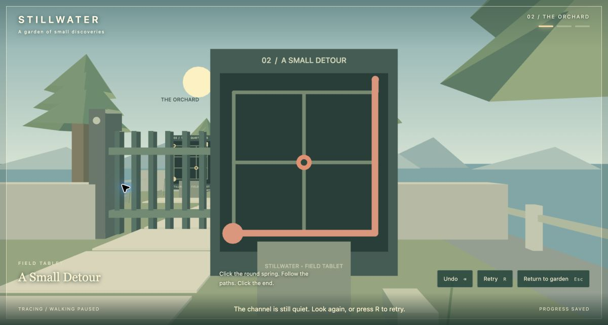
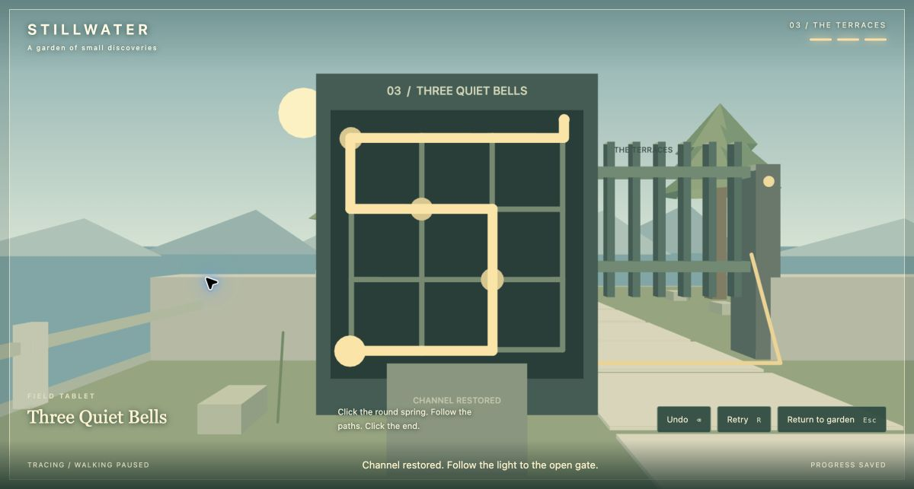
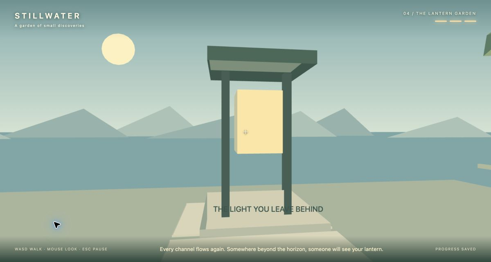
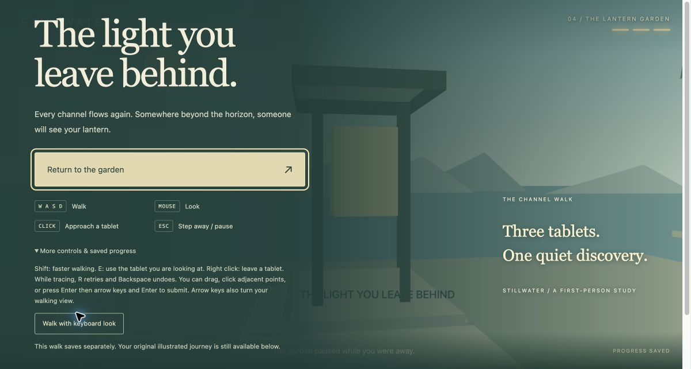
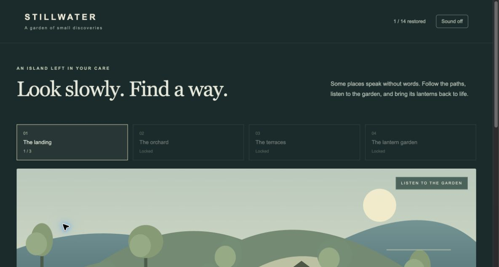
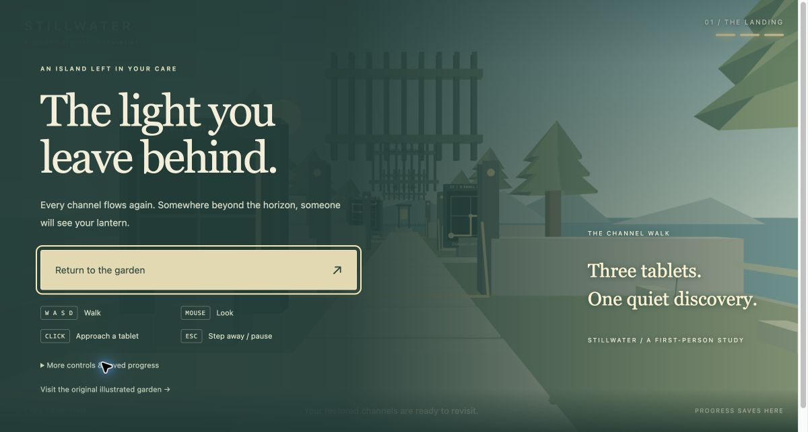

# Current interaction correction: pause versus leaving (2026-10-15)

This section supersedes the older cancellation/pause behavior recorded in the historical QA below. **E/right click and a valid solve return directly to active exploration. Escape pauses the current session; Resume restores walking or the same tablet and unfinished trace.**

Actual checkout: **23/23 tests passed**, including seven state-transition tests plus the E repeat/input tests; existing independent enumeration covers **1,888 routes**. Typecheck, production build and whitespace checks passed. Both independent review axes reported no remaining findings after the controls-document correction. ADR 0003 records the distinct transitions. No commit or push.

Native Google Chrome verification at `http://localhost:5207/` used a separate tab and normal clicks/held keys, without injected events or game-state setters:

- Held E entered First Light and stayed in it. Enter/Right/Up created an unfinished route. Escape opened a pause screen whose action was **Resume First Light**. Clicking it restored that same tablet and the visible right/up route; walking did not replace tracing.
- Held E for one second exited directly to the garden with the walking HUD and canvas focus, without a pause screen or held-repeat re-entry. Fresh E could enter again. The final build also verified the explicit **Back in the garden** status.
- Completed First Light with Enter/arrows/Enter. The puzzle controls disappeared immediately, walking HUD and success message appeared, and Chrome displayed its mouse-capture notice. This was a replay on the existing QA origin; the user’s 127.0.0.1 save and open tab were not reset or reloaded.
- Escape while exploring opened **Resume exploration**. A click restored canvas focus and mouse capture; holding S visibly moved backward in the world. Thus both pause return modes were observed, not inferred from passing unit tests.
- Started a new partial route, opened a normal temporary Chrome tab, then closed it. The game showed **The garden paused while you were away** and **Resume First Light**. Resume restored the partial rightward route visibly. No focus emulation or synthetic blur event was used for this follow-up.
- Right click from that panel also returned directly to walking. Temporary helper and QA tabs were closed; the original user tab and its position were preserved. **Native browser input was released after verification.**

Browser restriction handling: requests run synchronously from E, completion or Resume gestures. Native Chrome allowed capture to return in the tested flows. If a browser refuses, the model stays in active exploration and exposes an inline **Click for mouse look** prompt; WASD/arrow look remain active. Denial, delayed unlock, unexpected established-lock loss and late acquisition are tested at the state-transition seam. A denial was not forcibly manufactured in Chrome, so those fallback paths are unit/source evidence rather than observed browser denial.

Port **5207** remains on the original project PID **20337**, serving the rebuilt dist; no preview restart was needed. Existing atlas source/save format, puzzle data, dependencies and generated enumeration report remain unchanged. An already-open old build needs reload to use the corrected controls.

The written follow-up above records the current interaction checks. Six raw desktop captures are retained only in the local audit bundle because they include unrelated browser UI; they are intentionally omitted from this public record.

---

# Channel walk verification

2026-10-15, local Mac, existing Google Chrome profile intrepion, normal desktop viewport approximately 1200 × 643 (initial atlas 1172 × 699). Baseline `8671bb721fa0ec302c6da6de20fbebf9b4229480`; initial git status clean. Audit entry 38 was read and independently confirmed against the live atlas before implementation.

## Observed gameplay

- Native click entered mouse capture (Chrome displayed its Escape notice). Held W moved the scene; mouse motion visibly rotated the view. Arrow look and keyboard-look mode also worked.
- Approached First Light in the world; aimed click froze walking and brought the physical tablet close. Clicked its spring, moved the mouse through neighboring vertices, and clicked its end. The line, cable and gate lit; the gate lifted; walked through into the orchard.
- A Small Detour: submitted the perimeter using Enter/arrows, missing the seed. Red rejection feedback, highlighted missed seed, 1/3 progress and closed gate were visible. R/Retry cleared the editable trace. Backspace visibly undid an edge. Solved through the seed with keyboard tracing; saw 2/3 and the lifting gate, then walked through.
- Before solving Three Quiet Bells, held W into its closed gate and remained on the terraces in front of its bars. A second screenshot was not byte-identical because slightly oblique movement could slide sideways; this is visual collision evidence, not a claim of identical camera coordinates. Unit tests independently cover tunneling, blocking and sliding.
- Solved Three Quiet Bells with normal Enter/arrow input through all three seeds. Saw 3/3, the illuminated cable and lifting final gate. Walked through to the lantern; the ending message and Lantern Garden label appeared. Final approach used the supported keyboard-look mode after native pointer positioning changed the view during automation.
- Escape while walking released pointer lock and paused; W during pause did not resume play. Escape and right click left panels. Complete but unsubmitted routes were canceled with Return and retried with Retry through focused-button Enter, without unlocking the next gate. No storage or game-state setter was used.
- Browser tool focus emulation initially masked actual tab visibility/focus. Disabled that test-only emulation, switched natively to a separate blank helper tab, and read actual page flags: `hidden:true`, `focus:false`, pause visible, message “The garden paused while you were away.” Returned to the game and observed its paused ending. Restored the original emulation setting and closed the helper tab. No synthetic blur/visibility event was dispatched.
- Original atlas visited through its link: still 1/14 restored, matching the pre-edit preview. Its sources and storage key were not changed. Walking reload persistence is checked separately below.

## Supporting views

## Automated seams and limits

The new pure-domain tests cover closed/open gate movement, sliding and large movement steps, out-of-order progression, missing seeds, valid save reload, corrupt/malformed saved routes, and completion requiring all solves plus arrival. Existing validator and independent puzzle enumeration remain intact. Red/green work started with the gate-collision/progression test before its module existed; then added invalid-save and arrival slices. Review reports distinguish source reasoning from browser evidence.

No commercial executable, hardware gamepad, touch screen, screen reader, Safari, or Firefox comparison was run. This compact sequence does not establish fidelity for nonlinear island exploration or perspective/environment puzzles outside the requested sample. Native capture occasionally failed when automation left Chrome's content unfocused; the fallback message worked and a real native content click successfully captured it. No claim that those failed attempts were successful gameplay.

## Final checks

- Actual checkout: `npm test` **14/14 passed**; `npm run verify:puzzles` **14 puzzles / 1,888 routes**; `npm run typecheck` and `npm run build` passed. The first sandboxed test attempt could not write the existing enumeration report; the authorized rerun passed. That generated report remains identical to HEAD.
- Reloaded the completed localhost walk: **3/3**, ending heading, and all raised gates persisted at the landing. Then visited `http://127.0.0.1:5207/`: **0/3** on that separate origin, left open as a fresh local-play entry. No save was cleared or rewritten by a test hook.
- Original `src/main.ts`, `domain.ts`, `state.ts`, `puzzles.ts`, `art.ts`, `style.css`, package files and enumeration script/report compare identical to HEAD. New entry routing is the only default-entry change. Original atlas still showed **1/14** in the audited localhost origin.
- All **54/54** original TCP listeners retained. Port **5207** remained on its original project PID **20337**; Vite preview served the rebuilt dist without a process restart. No other preview was restarted.
- Independent recheck caught front panel markings showing through the rear casing after the compositing correction. Added a front-side guard; reviewer reproduced **0** rear grid strokes/labels and all expected front markings. Both review axes now have **0 outstanding findings**.
- No commit or push. Browser automation focus configuration was restored after testing; temporary helper tabs were closed. The only retained test-created tab is the requested fresh local-play page.

## Follow-up: E to leave a panel

2026-10-15. Added E exit through the existing `leavePanel` cancellation/pause/focus path, alongside Escape and right click. Visible panel button, tracing HUD, pause controls, README and design document now describe E. `interactionKeyAction` is the public input seam: fresh E enters in walking mode or leaves panel mode; repeated E does neither. Two regression tests cover the transition sequence, suppression in panel/walk/pause, and equivalence with Escape.

Actual checkout checks passed: **16/16 tests**, existing independent enumeration **1,888 paths**, typecheck, production build, and whitespace checks. Independent read-only review reported no findings. Original preview PID **20337** remained on port **5207**; no commit/push.

Native Chrome verification used a separate localhost tab and ordinary clicks/held keys. Approached First Light, held E for 1.1 seconds: entered and remained in panel mode. Started an unfinished trace with Enter/Right, then held E for 1.1 seconds: exited to the same safe pause screen, Resume held focus, progress remained 3/3. Resumed with a click (canvas focus restored), re-entered with a fresh E press, and visibly confirmed the canceled trace was empty. Tabbed to Undo and pressed E: exited correctly from button focus. No submit, save reset, game-state mutation, or storage setter was used. Closed only the temporary native QA tab and returned Chrome to its previous tab.

The browser extension requested an update during tab management; native Chrome accessibility/input/screenshot control remained available and completed verification. The existing user game tab and its position were not reloaded. Reload the game to load the new shortcut in an already-open old build.
